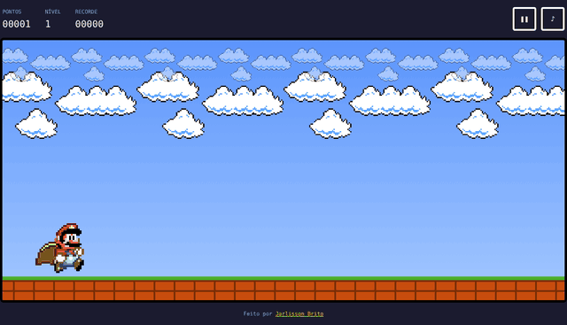
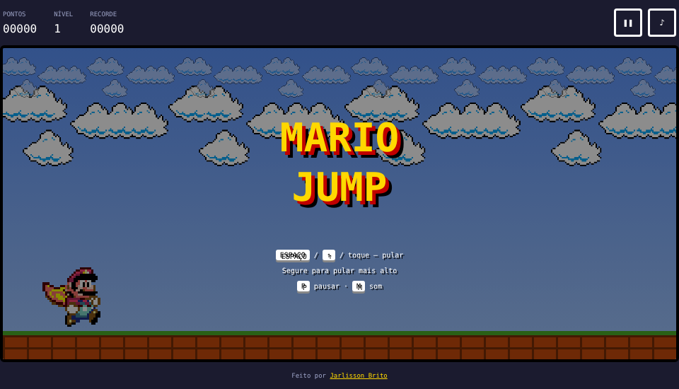
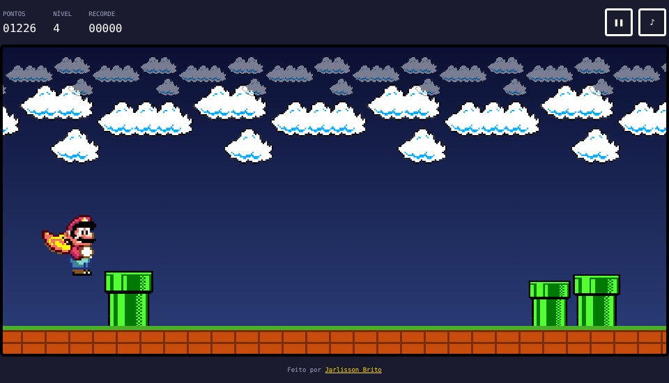
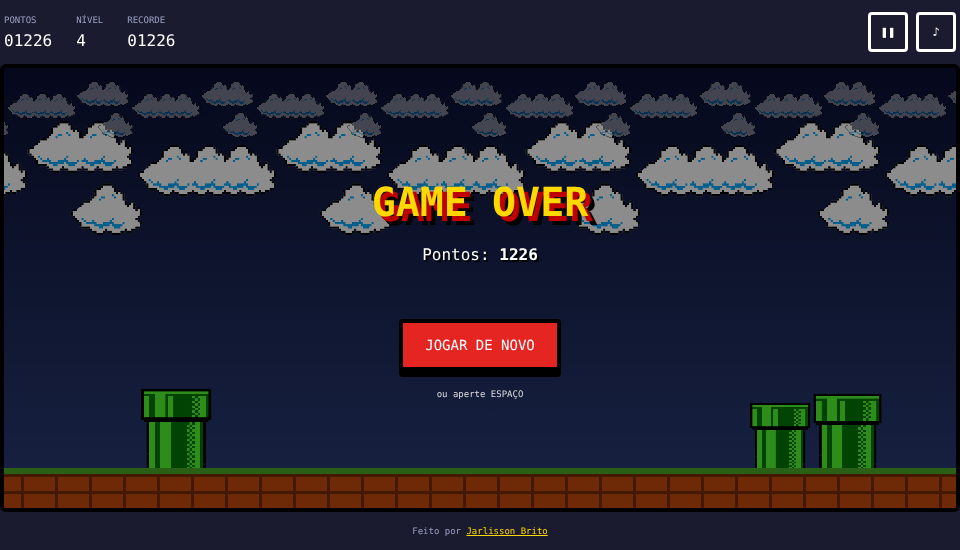

<h1 align="center">🍄 Mario Jump</h1>

<p align="center">
  Jogo de pular canos feito com <strong>HTML, CSS e JavaScript puro</strong>, sem bibliotecas nem frameworks.
</p>

<p align="center">
  <a href="https://jarlisson-cpu.github.io/mario-jump/"><strong>▶ JOGAR AGORA</strong></a>
</p>

<p align="center">
  
  
  
  
</p>

<p align="center">
  
</p>

---

## 📋 Sumário

- [Sobre](#-sobre)
- [Funcionalidades](#-funcionalidades)
- [Controles](#-controles)
- [Como executar](#-como-executar)
- [Estrutura do projeto](#-estrutura-do-projeto)
- [Como o código funciona](#-como-o-código-funciona)
- [Personalize](#-personalize)
- [Telas](#-telas)
- [Próximos passos](#-próximos-passos)
- [Autor](#-autor)
- [Licença](#-licença)

## 📖 Sobre

O **Mario Jump** começou como um exercício de mentoria de programação (um cano que anda e um Mario que pula com CSS) e evoluiu para um jogo completo: física de pulo, níveis de dificuldade, recorde salvo, sons e versão para celular.

O objetivo do projeto é praticar **manipulação do DOM**, **game loop**, **detecção de colisão** e **CSS responsivo** usando apenas o que o navegador já oferece.

## ✨ Funcionalidades

- 🏃 **Pulo com física real**: gravidade, pulo curto (toque) e pulo alto (segurando)
- 📈 **Níveis de dificuldade**: a cada 400 pontos o jogo fica mais rápido
- 🌅 **Céu dinâmico**: dia → pôr do sol → crepúsculo → noite conforme o nível
- 🟩 **Canos variados**: tamanhos diferentes e canos duplos a partir do nível 3
- 🏆 **Recorde salvo** no navegador (`localStorage`)
- ☁️ **Parallax**: nuvens em duas camadas e chão em movimento
- 🔊 **Efeitos sonoros** gerados com a Web Audio API (sem arquivos de áudio)
- ⏸️ **Pausa** manual e automática ao trocar de aba
- 📱 **Responsivo**: funciona no computador e no celular (toque)

## 🎮 Controles

| Ação | Teclado | Celular |
|---|---|---|
| Começar / pular | `Espaço`, `↑` ou `W` | tocar na tela |
| Pulo mais alto | segurar a tecla | segurar o dedo |
| Pausar | `P` ou `Esc` | botão ❚❚ |
| Ligar / desligar som | `M` | botão ♪ |
| Jogar de novo | `Espaço` | botão "Jogar de novo" |

## 🚀 Como executar

**Online:** acesse **https://jarlisson-cpu.github.io/mario-jump/**

**No seu computador:**

```bash
git clone https://github.com/Jarlisson-cpu/mario-jump.git
cd mario-jump
```

Depois é só abrir o `index.html` no navegador, ou usar a extensão **Live Server** do VS Code.
Não precisa instalar nada.

## 📁 Estrutura do projeto

```
mario-jump/
├── index.html          # estrutura da página (placar, tabuleiro e telas)
├── style.css           # visual, animações e layout responsivo
├── script.js           # lógica do jogo (loop, física, colisão, sons)
├── assets/
│   └── images/         # sprites: Mario, cano, nuvens e game over
├── docs/               # imagens usadas neste README
├── LICENSE
└── README.md
```

## 🧠 Como o código funciona

1. **Game loop** — `requestAnimationFrame` chama a função `loop()` cerca de 60 vezes por segundo.
2. **Delta time (`dt`)** — todo movimento é multiplicado pelo tempo entre quadros, então o jogo roda na mesma velocidade em qualquer computador.
3. **Física do pulo** — o Mario recebe uma velocidade para cima que a gravidade diminui a cada quadro. Se o jogador solta a tecla cedo, a subida é cortada (pulo curto).
4. **Colisão AABB** — comparamos duas caixas retangulares (Mario e cano), um pouco menores que as imagens, para a colisão parecer justa.
5. **Máquina de estados** — o jogo está sempre em um estado: `start`, `playing`, `paused`, `dying` ou `over`.
6. **Escala** — Mario, canos e velocidade são calculados a partir do tamanho do tabuleiro, por isso o jogo se adapta a telas pequenas.

## 🛠️ Personalize

Os números principais ficam no objeto `CONFIG`, no topo do `script.js`:

```js
const CONFIG = {
    baseSpeed: 430,        // velocidade inicial dos canos
    speedPerLevel: 0.12,   // +12% de velocidade por nível
    pointsPerLevel: 400,   // pontos para subir de nível
    jumpHeight: 0.52,      // altura do pulo segurando
    shortHop: 0.40,        // altura do pulo com um toque
    // ...
};
```

Mude os valores, salve e recarregue a página para ver a diferença.

## 🖼️ Telas

| Tela inicial | Jogando | Game over |
|---|---|---|
|  |  |  |

## 🗺️ Próximos passos

- [ ] Inimigos além dos canos (ex.: Goombas)
- [ ] Moedas para coletar
- [ ] Ranking online
- [ ] Música de fundo

Sugestões são bem-vindas: abra uma [issue](https://github.com/Jarlisson-cpu/mario-jump/issues).

## 👤 Autor

**Jarlisson Brito**

[](https://github.com/Jarlisson-cpu)
[](https://www.linkedin.com/in/jarlisson-brito-602909368/)

## 📄 Licença

O **código** deste projeto está sob a licença [MIT](LICENSE).

Mario e os elementos visuais relacionados são marcas registradas da **Nintendo**. Este é um projeto de fã, feito para estudo e sem fins comerciais. As imagens não estão cobertas pela licença MIT.
